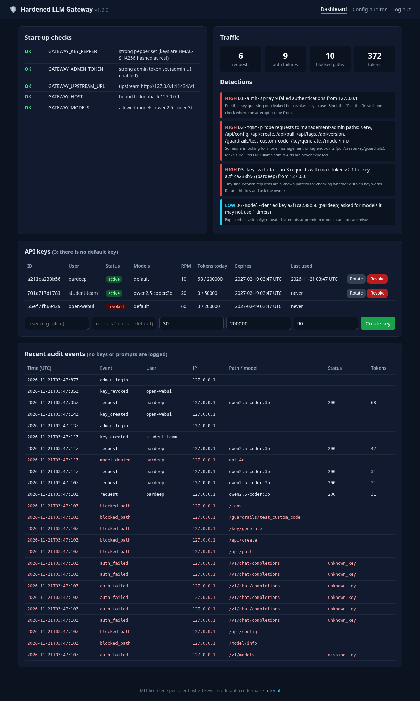
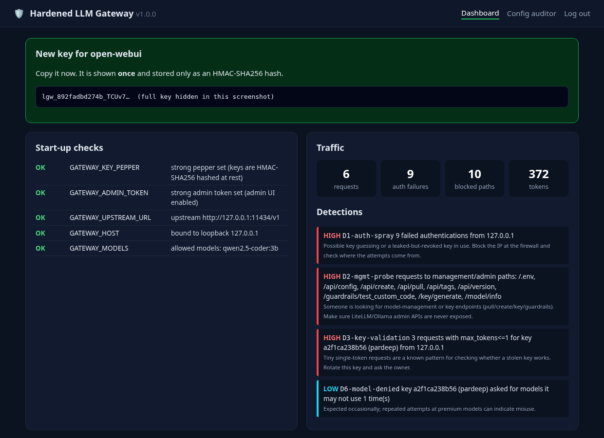
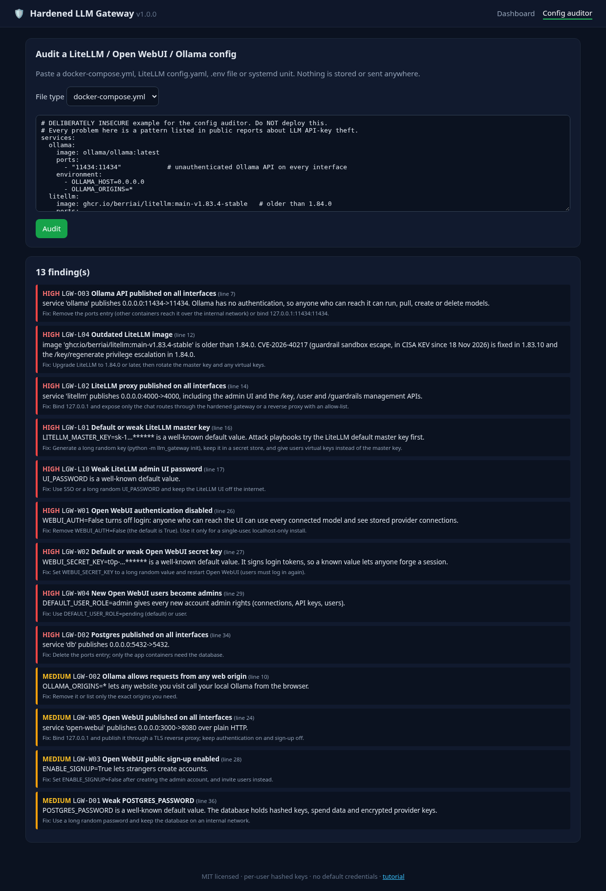
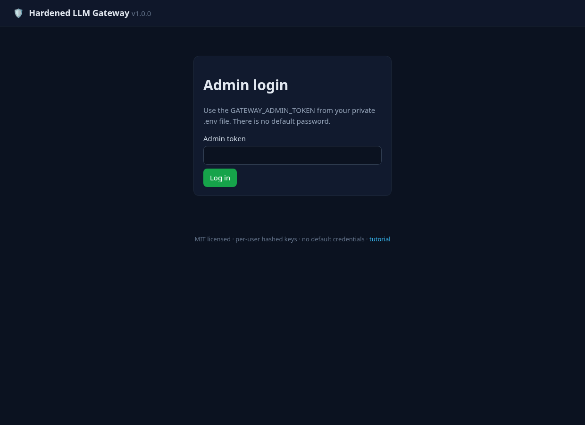
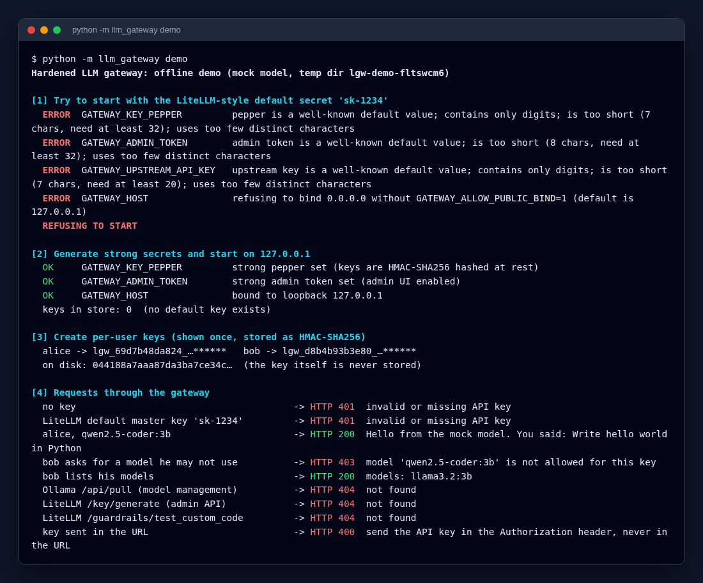
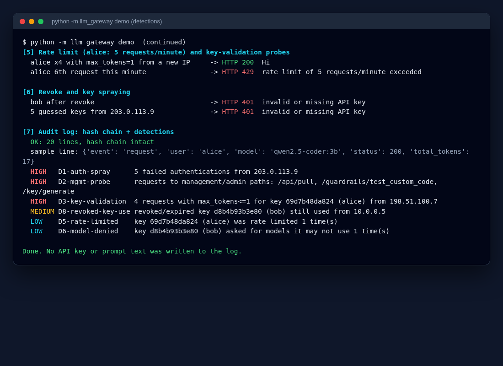
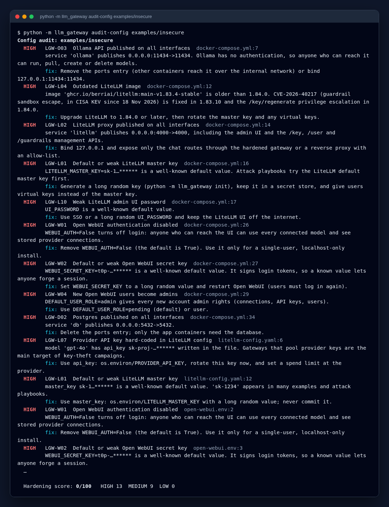
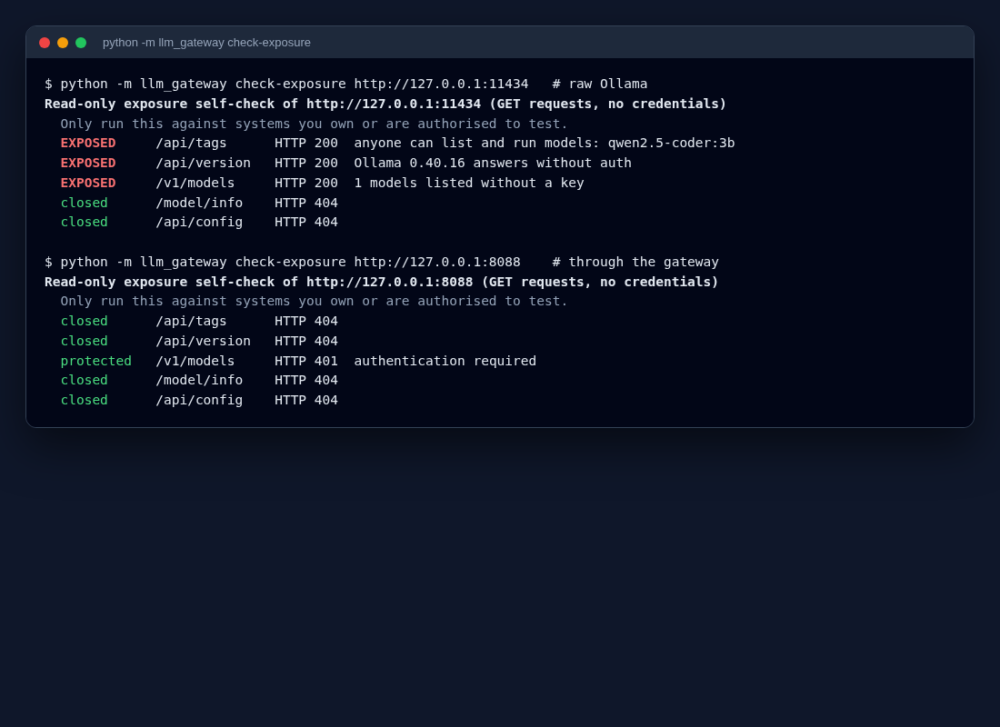
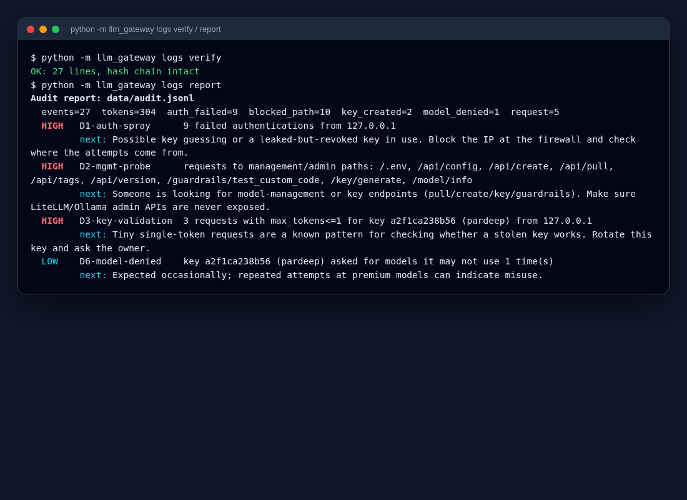
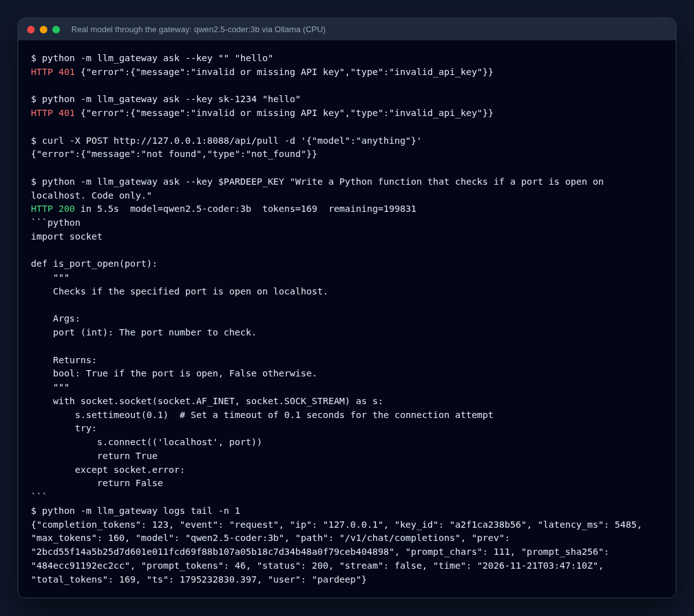

# Hardened LLM Gateway (Python): Secure Self-Hosted Ollama, LiteLLM & Open WebUI

A **hardened, self-hosted LLM gateway** that sits in front of **Ollama**, **LiteLLM** or any OpenAI-compatible
server, plus a **config auditor** for LiteLLM / Open WebUI / Ollama deployments.

- **Per-user API keys, hashed at rest** (HMAC-SHA256 with a server-side pepper). Shown once, never stored.
- **No default keys, no master key, no admin/admin.** A fresh gateway has zero keys and rejects everything.
- **Refuses to start** with default or weak secrets (`sk-1234`, `changeme`, `t0p-s3cr3t`, short or low-entropy values),
  a world-readable key file, or a public bind address without an explicit opt-in.
- **Rate limits** (requests/minute per key), **daily token budgets**, **IP lock-out** after failed logins,
  per-key **model allow-lists**, `max_tokens` cap and body-size limit.
- **Only chat, embeddings and model-list routes are served.** Ollama `/api/pull`, `/api/create`, `/api/delete`,
  LiteLLM `/key/*`, `/guardrails/*`, `/config` and everything else return 404 and are logged.
- **Hash-chained JSONL audit log** (no API keys, no prompt text) with `logs verify` and a `logs report` that flags
  key spraying, management-path probes, `max_tokens=1` key-validation sweeps, keys used from many IPs,
  revoked keys still in use and unusual spend.
- **Config auditor**: scans `docker-compose.yml`, LiteLLM `config.yaml`, `.env` files and systemd units for default
  master keys, exposed ports (11434, 4000, 5432), `WEBUI_AUTH=False`, open sign-up, hard-coded provider keys and
  LiteLLM images older than 1.84.0.
- **Read-only exposure self-check** of your own endpoints, a **CLI**, a small **Flask admin UI**, a hardened
  **docker-compose** stack, and **190 pytest tests**. MIT licensed.

Full tutorial: **[Hardened LLM Gateway in Python: Secure Self-Hosted Ollama, LiteLLM and Open WebUI](https://getprojects.org/hardened-llm-gateway-python/)**

> **Why now?** On 13 Nov 2026 Amazon Threat Intelligence reported AI agents running a large, self-funding campaign
> to steal LLM API keys from internet-exposed AI gateways and apps, including LiteLLM, Open WebUI and Ollama. Their
> playbook listed default admin credentials such as the LiteLLM default master key, unauthenticated management
> endpoints and secrets in config files ([AWS Security Blog, 13 Nov 2026](https://aws.amazon.com/blogs/security/amazon-threat-intelligence-observes-threat-actors-running-cybercrime-campaigns-with-artex-ai-agents/)).
> Google's LLMjacking report described attackers abusing exposed Ollama endpoints and a LiteLLM `/key/regenerate` flaw
> ([Google Cloud, 2 Nov 2026](https://cloud.google.com/blog/topics/threat-intelligence/llmjacking-monetizing-compromised-cloud-models)),
> and CISA added LiteLLM CVE-2026-40217 to its KEV catalog on 18 Nov 2026
> ([CSA research note, 20 Nov 2026](https://labs.cloudsecurityalliance.org/research/csa-research-note-litellm-cve-2026-40217-kev-20261120-csa-st/)).
> This project is strictly **defensive**: detect, harden and monitor.



## Quick start

```bash
git clone https://github.com/GetProjectsIdea/Hardened-LLM-Gateway-Python.git
cd Hardened-LLM-Gateway-Python
python -m venv .venv && source .venv/bin/activate      # Windows: .venv\Scripts\activate
pip install -r requirements-dev.txt

python -m llm_gateway demo                 # offline walkthrough, mock model, no GPU needed
python -m pytest -q                        # 190 tests

python -m llm_gateway init                 # writes .env with a random pepper + admin token (chmod 600)
python -m llm_gateway keys create alice    # prints the key ONCE; only a hash is stored
python -m llm_gateway serve                # 127.0.0.1:8088 -> Ollama at 127.0.0.1:11434/v1
```

Use it from any OpenAI-compatible client:

```bash
curl http://127.0.0.1:8088/v1/chat/completions \
  -H "Authorization: Bearer $ALICE_KEY" -H "Content-Type: application/json" \
  -d '{"model":"qwen2.5-coder:3b","messages":[{"role":"user","content":"Hello"}]}'
```

```python
from openai import OpenAI
client = OpenAI(base_url="http://127.0.0.1:8088/v1", api_key=ALICE_KEY)
print(client.chat.completions.create(model="qwen2.5-coder:3b",
      messages=[{"role": "user", "content": "Hello"}]).choices[0].message.content)
```

Audit your existing stack (read-only, never changes files):

```bash
python -m llm_gateway audit-config ./my-llm-stack            # exit code 1 if HIGH findings
python -m llm_gateway audit-config examples/insecure --json  # machine-readable, for CI
python -m llm_gateway check-exposure http://127.0.0.1:11434  # your own host only
python -m llm_gateway logs verify && python -m llm_gateway logs report
```

## Screenshots

| | |
|---|---|
|  Admin dashboard: start-up checks, detections, keys, audit log |  A new key is shown once, then only its hash is kept |
|  Config auditor flags 13 problems in an insecure compose file |  Admin login, no default password |
|  Demo: refuses `sk-1234`, blocks management paths |  Demo: rate limit, revoke, detections |
|  `audit-config` on the insecure examples |  Raw Ollama is open, the gateway is not |
|  `logs verify` and `logs report` |  Real model (qwen2.5-coder:3b via Ollama, CPU) through the gateway |

## How it works

```
client (curl / OpenAI SDK / Open WebUI)
   │  Authorization: Bearer lgw_<id>_<secret>
   ▼
┌────────────────────────── hardened gateway ──────────────────────────┐
│ IP lock-out → route allow-list → key HMAC check → rate limit/budget  │
│ → JSON + model allow-list + max_tokens cap → forward → audit (JSONL) │
└───────────────────────────────────────────────────────────────────────┘
   │  gateway's own upstream key (never sent to clients or logs)
   ▼
Ollama / LiteLLM / vLLM on a private network (no published ports)
```

## Project structure

```
Hardened-LLM-Gateway-Python/
├── llm_gateway/
│   ├── gateway.py        # Flask app: auth, limits, allow-lists, forwarding, admin UI
│   ├── keys.py           # per-user keys, HMAC-SHA256 at rest, expiry, revoke, rotate
│   ├── secrets_check.py  # default/weak secret detection, provider-key patterns
│   ├── settings.py       # env settings + preflight (refuses to start on ERROR)
│   ├── ratelimit.py      # token bucket, daily token budget, IP lock-out
│   ├── audit.py          # hash-chained JSONL audit log + detections
│   ├── auditor.py        # LiteLLM / Open WebUI / Ollama / compose config auditor
│   ├── exposure.py       # read-only self-check of your own endpoints
│   ├── upstream.py       # OpenAI-compatible HTTP upstream + offline mock
│   ├── cli.py, demo.py, wsgi.py
│   ├── templates/, static/
├── examples/
│   ├── insecure/         # deliberately bad configs for the auditor (do not deploy)
│   └── secure/           # hardened docker-compose + LiteLLM config
├── tests/                # 190 pytest tests
├── docs/                 # screenshots and sample runs
├── Dockerfile            # non-root image
└── pyproject.toml, requirements*.txt, LICENSE
```

## Configuration (environment variables)

| Variable | Default | Notes |
|---|---|---|
| `GATEWAY_KEY_PEPPER` | (required) | 32+ random chars; keys are HMAC-SHA256(pepper, key). Changing it invalidates all keys. |
| `GATEWAY_ADMIN_TOKEN` | empty | Enables the admin UI. Must be strong and different from the pepper. |
| `GATEWAY_UPSTREAM_URL` | `http://127.0.0.1:11434/v1` | Ollama, LiteLLM, vLLM, llama.cpp server… |
| `GATEWAY_UPSTREAM_API_KEY` | empty | e.g. a LiteLLM virtual key. Rejected if weak (`sk-1234`). |
| `GATEWAY_MODELS` | `qwen2.5-coder:3b` | Comma-separated global model allow-list. |
| `GATEWAY_HOST` / `GATEWAY_PORT` | `127.0.0.1` / `8088` | Non-loopback needs `GATEWAY_ALLOW_PUBLIC_BIND=1`. |
| `GATEWAY_KEYS_FILE` / `GATEWAY_AUDIT_LOG` | `data/keys.json` / `data/audit.jsonl` | Both written with mode 600. |
| `GATEWAY_MAX_TOKENS` / `GATEWAY_MAX_BODY_KB` | `2048` / `256` | Hard caps per request. |
| `GATEWAY_TRUST_PROXY` | `0` | Use `X-Forwarded-For` only behind your own reverse proxy. |
| `GATEWAY_AUTH_FAIL_LIMIT` | `10` | Failed auths per IP in 5 min before a 15 min block. |

## Config auditor rules

| Rule | Severity | What it finds |
|---|---|---|
| LGW-L01 | HIGH | Default/weak LiteLLM master key (e.g. `sk-1234`) |
| LGW-L02 | HIGH | LiteLLM port 4000 published on all interfaces |
| LGW-L04 / L03 | HIGH / MEDIUM | LiteLLM image older than 1.84.0 / not pinned |
| LGW-L05 | HIGH | LiteLLM config without a master key |
| LGW-L07 | HIGH | Provider API key hard-coded in LiteLLM config |
| LGW-L08 | MEDIUM | Custom-code guardrail (CVE-2026-40217 surface) |
| LGW-W01 / W02 / W04 | HIGH | `WEBUI_AUTH=False`, weak `WEBUI_SECRET_KEY`, `DEFAULT_USER_ROLE=admin` |
| LGW-W03 / W05 | MEDIUM | Open sign-up, Open WebUI published on all interfaces |
| LGW-O03 | HIGH | Ollama 11434 published on all interfaces |
| LGW-O01 / O02 | MEDIUM | `OLLAMA_HOST=0.0.0.0`, `OLLAMA_ORIGINS=*` |
| LGW-D01 / D02 | MEDIUM / HIGH | Weak DB password, Postgres/Redis published |
| LGW-S01 / S02 | HIGH / MEDIUM | Provider keys in files, placeholder secrets |
| LGW-G01, C01, C02, … | various | Weak gateway secrets, privileged containers, host networking |

## Docker

```bash
cd examples/secure
python -m llm_gateway init --env-file .env     # then add WEBUI_SECRET_KEY and OPENWEBUI_GATEWAY_KEY
docker compose --env-file .env up -d --build
docker compose exec gateway python -m llm_gateway keys create alice
```

Ollama has **no published ports**, the gateway and Open WebUI listen on **127.0.0.1 only** (publish them through a TLS
reverse proxy), Open WebUI talks to models **only through the gateway** with its own key, and the gateway container is
read-only, non-root and drops all capabilities. For production use gunicorn: `gunicorn -w 1 -b 0.0.0.0:8088 llm_gateway.wsgi:app`.

## Limits (be honest in your viva)

- Rate limits and token budgets are in memory, per process. Use one worker or move them to Redis for strict limits.
- Streaming requests are answered as a single SSE chunk (the gateway needs the full response to count tokens).
- The gateway does not replace patching: keep LiteLLM, Open WebUI and Ollama up to date.
- `check-exposure` sends a few unauthenticated GET requests. Use it only on systems you own or are authorised to test.

## Ideas to extend (final-year project)

Redis-backed limits, OIDC/SSO for the admin UI, per-team budgets with email alerts, Prometheus metrics, a SIEM
forwarder for the JSONL log, prompt-injection filters, SARIF output for the auditor in GitHub Actions.

## License

MIT © 2026 Pardeep Patel / [GetProjects.org](https://getprojects.org/)
